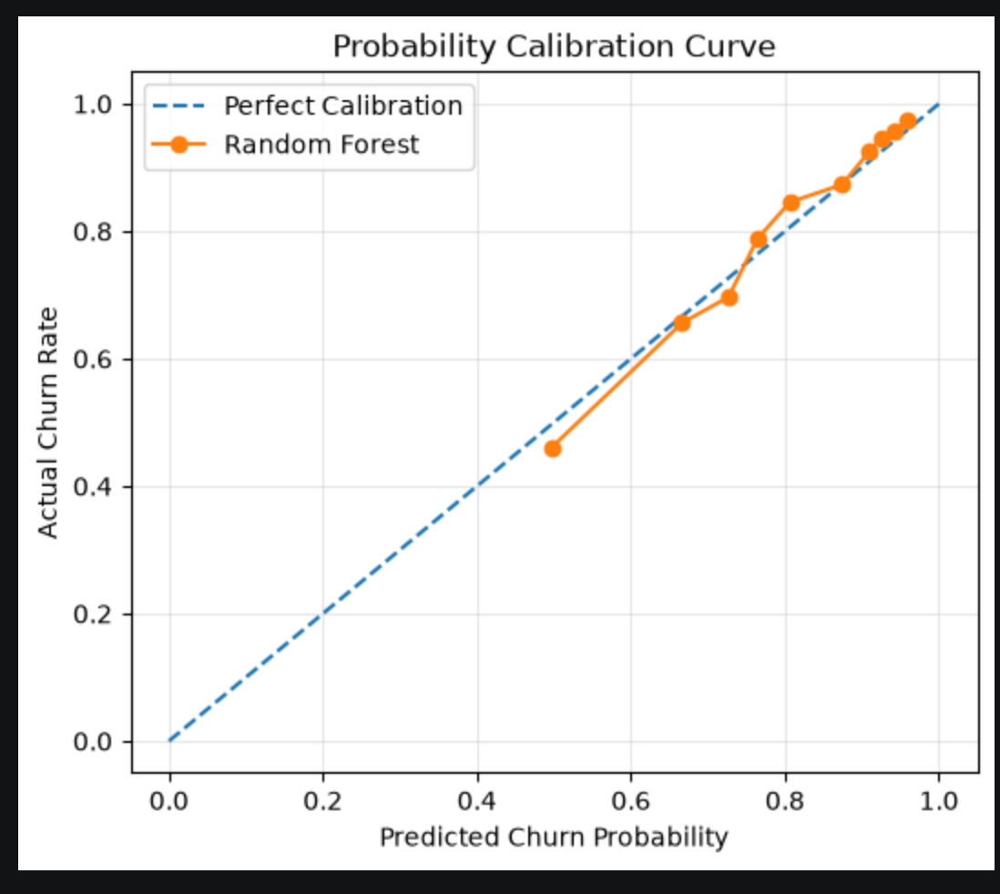

# E-commerce Customer Churn Analysis

**Dataset:** REES46 event data, October 2019–April 2020  
**Analysis unit:** Previously purchasing users in a 100,000-user development sample  
**Report date:** 15 October 2026  
**Repository handoff updated:** 18 October 2026  
**Status:** The saved 15-feature candidate has been reproduced on its reconstructed historical test split. A single fixed temporal backtest is also documented; untouched final model-selection validation remains outstanding.

## 1. Executive Summary

This project examines which historical behaviors are associated with a lack of repeat purchasing and identifies customer segments for retention experiments. Churn means **no observed purchase during March–April 2020**, among users with at least one purchase before March 2020. It does not mean permanent departure from the platform.

The eligible cohort contains 9,428 users: 7,658 churned and 1,770 retained, corresponding to an observed churn rate of **81.23%**. Recent browsing activity distinguishes groups with substantially different subsequent purchase outcomes: churn is 69.57% among users with browsing in the preceding 30 days and 92.88% among those without it.

Across three reported Random Forest experiments, the 15-feature model has the highest reported ROC AUC (0.7808) and macro F1 (0.6637). Its accuracy and macro F1 have now been reproduced at classification threshold 0.70, with ROC AUC reproduced from the same probability scores. Repeated inspection of the test set means these results are exploratory comparisons, rather than an independent estimate of generalization.

Inactive customers with higher historical spending constitute a useful segment to investigate: 2,195 users, with 92.39% observed churn. Their historical value motivates a retention experiment, but does not establish that they are more responsive to marketing or that intervention will be profitable.

On the original historical test set, the owner-confirmed top 10% ranking captures a group with 97.34% observed churn (lift 1.1983), versus 93.14% for the mean tie-randomized browsing rule. A separate fixed temporal backtest with 6,717 earlier training users and 6,445 later test users achieved AUC 0.7351 and macro F1 0.6374; top 10% precision was 94.25% (lift 1.2265). These results indicate risk-screening value, not proven campaign return. The temporal design and its caveats are detailed in Section 5.7.

## 2. Evidence and Verification Scope

This report combines user-confirmed experimental results with inspection of the accessible local project, including `notebooks/01_data_quality.ipynb`, `notebooks/01_data_quality.recovered.ipynb`, and files in `data/sample/`.

The original notebook contains 96 cells, of which 33 have non-null execution counts. The recovered notebook contains 99 cells with no saved execution counts. Saved outputs in the original notebook corroborate the 100,000-user sample, the 9,428-user eligible cohort, and the retained/non-retained counts. These saved outputs alone do not certify a successful clean-kernel run.

The two notebooks inspected do not contain the Random Forest experiments. A separate exported Python analysis file was subsequently located under `notebooks/`; it documents the earlier 80/20 stratified random split (`random_state=42`) and zero-filling of missing event ratios. The saved pickle supplies the exact candidate feature order, estimator parameters and threshold. Reconstructing that split on the cached row order and retraining reproduces every saved tree's node/value arrays and all-user probabilities within floating-point tolerance (maximum difference below 1e-14). The 15-feature model's reported metrics are therefore reproduced on the reconstructed historical test split; the 11- and 18-feature rows remain owner-reported.

Read-only queries independently confirmed descriptive statistics. All 15 model inputs and labels were also rebuilt from `session_events.parquet` and matched the feature cache (numeric tolerance for floating sums). This is an event-cache-to-model check, not a raw-CSV-to-model clean run. See [the audit](reproducibility_audit.md) and [validation results](../validation/validation_summary.md).

**18 October evidence integration:** Original-test top-K results and the 1,000-repeat rule comparison are supported by code and user-posted output tables recovered directly from the 项目开发 conversation; its original calibration-chart attachment was also recovered. See [the evidence archive](../validation/ranking_calibration/README.md). The Brier score matches existing historical metrics. Temporal figures were checked against the existing [temporal metrics](../validation/temporal_validation/results/metrics.json), script and English addendum. This integration reads completed artifacts only: it does not rerun training, ranking, probability calibration or temporal validation.

## 3. Data and Target Definition

### 3.1 Data scope and sampling

The source consists of seven monthly event files covering October 2019 through April 2020. The notebook constructs the development sample by selecting 100,000 distinct user IDs ordered by `hash(user_id)` and retaining their events. This is user-level sampling, rather than selecting 100,000 event rows.

The sampling universe includes users observed anywhere in the seven-month extract. Therefore, the sample construction is retrospective; a future deployment should define its scoring population using information available at the scoring date. Preserve the selected user-ID list and DuckDB version to make hash-based sampling reproducible.

### 3.2 Observation and outcome windows

| Component | Definition |
|---|---|
| Historical feature window | 1 October 2019 inclusive to 1 March 2020 exclusive |
| Scoring cutoff | 1 March 2020 |
| Prediction/outcome window | 1 March 2020 inclusive to 1 May 2020 exclusive |
| Eligibility | At least one historical purchase event |
| `churn = 1` | No purchase event in the outcome window |
| `churn = 0` | At least one purchase event in the outcome window |
| Recent 30-day window | 31 January 2020 inclusive to 1 March 2020 exclusive |

The recent window is exactly 30 days; it is not equivalent to the calendar month of February 2020.

| Outcome | Users | Share of eligible cohort |
|---|---:|---:|
| Churned | 7,658 | 81.23% |
| Retained | 1,770 | 18.77% |
| Total | 9,428 | 100.00% |

Saved notebook outputs further split non-retained users into 5,070 with no future events and 2,588 with future activity but no purchase. Both are churned under this purchase-based definition.

### 3.3 Measurement conventions

- **Purchase count** counts purchase event rows, not distinct orders. Multiple product-level events may belong to one transaction.
- **Historical spending** sums `price` over purchase event rows. It is an observed spending proxy, not verified net revenue, profit, or customer lifetime value. Currency, refunds, cancellations, and transaction deduplication have not been independently established.
- **Purchase recency** measures days from the last historical purchase to the scoring cutoff.
- **Historical sessions** are reconstructed per user, beginning a new session at the first event or when the gap exceeds 30 minutes. A reconstructed session number is only unique within a user.
- **Recent sessions used by the saved model cache** count distinct `rebuilt_session` values per user within the recent window, consistent with historical sessions. The recovery notebook previously counted source `user_session` IDs, differing for 2,468 eligible users. It has now been corrected in the original project to use reconstructed sessions, with event-level and saved-input checks; actual-path recovery execution passed. The supplied validation script uses the same reconstructed-session convention.

## 4. Feature Engineering and Leakage Controls

The inspected code derives historical purchase recency, purchase sessions, spending, total sessions, view/cart/purchase event counts, event ratios, average spending per purchase event, and last-activity recency. Corrected recovery code also generates recent view, cart, purchase, and reconstructed-session counts.

The saved model confirms this ordered 15-feature input schema:

```text
recency_days, purchase_sessions, total_spend, total_sessions,
view_count, cart_count, purchase_count, cart_rate, purchase_rate,
no_view_before, purchase_session_rate, recent_30d_views,
recent_30d_carts, recent_30d_purchases, recent_30d_sessions
```

The candidate uses raw numeric inputs with missing `cart_rate` and `purchase_rate` filled with zero (34 users have missing values in each); no scaling or log transform is used. The exact 11- and 18-feature experiment specifications have not been independently reconstructed.

Zero-view users receive missing values for ratios with view counts as their denominator, together with a `no_view_before` indicator. The reproduced candidate fills these undefined ratios with zero and retains the no-view indicator; this constant replacement learns no statistics from test data.

Historical feature queries inspected use timestamps before 1 March 2020; outcome queries use later events. This separation is necessary to prevent future behavior entering predictors. The reproduced model uses a stratified random user split, **not temporal validation**. Exclude `churn`, `future_status`, future event counts, identifiers, and label-derived summaries from model inputs.

The inspected outcome SQL has a lower time bound but no explicit upper bound. Its intended March–April interpretation depends on the extract ending in April. Add an explicit `< '2020-05-01'` bound before using the pipeline with expanded data. Also document timezone handling and deterministic tie-breaking for equal event timestamps.

## 5. Model Comparison and Candidate Selection

### 5.1 Reported experiment results

| Random Forest experiment | Features | Accuracy | Macro F1 | ROC AUC |
|---|---:|---:|---:|---:|
| Initial model | 11 | 0.8091 | 0.6517 | 0.7555 |
| Candidate model | 15 | 0.7900 | **0.6637** | **0.7808** |
| Expanded model | 18 | 0.7900 | 0.6623 | 0.7801 |

The 15-feature row is now reproduced at threshold 0.70 on a reconstructed 1,886-user historical test split (354 retained; 1,532 churned), with 7,542 training users. The 11- and 18-feature rows remain project-owner-reported; their threshold-specific results have not been independently checked. ROC AUC uses continuous scores and does not change with classification threshold.

Relative to the 11-feature model, the 15-feature model improves reported macro F1 by 0.0120 and ROC AUC by 0.0253, while accuracy decreases by 0.0191. The 18-feature experiment provides no reported improvement over the 15-feature candidate. The differences between the latter two are small and do not establish statistical superiority.

Because the cohort is imbalanced, accuracy alone is misleading. Predicting churn for every eligible user would achieve 81.23% accuracy on the **full cohort**, exceeding all three reported accuracies. A matched all-churn baseline on the reconstructed test split achieves accuracy 0.8123 and macro F1 0.4482; the candidate at 0.70 trades lower accuracy for higher macro F1. Its full-cohort macro F1 would be approximately 0.4482 and constant-score ROC AUC 0.5. The candidate improves macro F1 and ranking discrimination over this matched baseline, but does not improve accuracy at 0.70.

### 5.2 Candidate configuration

```python
RandomForestClassifier(
    n_estimators=200,
    max_depth=5,
    min_samples_leaf=20,
    random_state=42,
)
```

The proposed decision rule is to classify a user as churned when the estimated probability of `churn = 1` is at least **0.70**. Verify the class-to-probability-column mapping when implementing it. The threshold is a candidate operating choice, not a validated optimum or an estimate of marketing responsiveness.

The trusted local artifact `data/sample/churn_model_v2.pkl` was loaded and its feature order, classes `[0, 1]`, full estimator settings and saved threshold verified. It additionally sets `n_jobs=-1`. A fresh fit reproduces all 200 saved tree states and probabilities within floating-point tolerance. A probability-calibration check is documented in Section 5.6; optimal calibration is not established.

### 5.3 Evaluation interpretation

The test set was viewed repeatedly during development. Model and threshold selection informed by those views can produce optimistic results; the reported scores are not independent generalization estimates.

For a stronger evaluation, freeze the feature specification and pipeline, select settings on validation data, and evaluate once on an untouched holdout. Where sufficient history exists, use later scoring dates with fully observed outcome windows and prevent overlapping user/window information from contaminating evaluation. Additional data would be needed to validate beyond the April 2020 extract.

### 5.4 Reproduced performance at threshold 0.70

| Measure | Value |
|---|---:|
| Accuracy | 0.7900 |
| Macro F1 | 0.6637 |
| ROC AUC | 0.7808 |
| Average precision (positive class: churn) | 0.9304 |
| Brier score | 0.1275 |
| Predicted churned users | 1,510 / 1,886 |

Average precision summarizes the precision–recall curve; it is not trapezoidal PR AUC. Brier score is a probability-error measure, not evidence that probabilities are calibrated.

| Actual outcome | Predicted retained | Predicted churned |
|---|---:|---:|
| Retained (0) | 167 | 187 |
| Churned (1) | 209 | 1,323 |

| Class | Precision | Recall | F1 | Support |
|---|---:|---:|---:|---:|
| Retained | 0.4441 | 0.4718 | 0.4575 | 354 |
| Churned | 0.8762 | 0.8636 | 0.8698 | 1,532 |

At threshold 0.50, the same model has accuracy 0.8208 and macro F1 0.5582. Raising the threshold to 0.70 improves retained-class recall from 0.1328 to 0.4718 and reduces false churn alarms from 307 to 187, while churn recall falls from 0.9798 to 0.8636 and missed churn cases rise from 31 to 209. Thus 0.70 offers a different error tradeoff; it is not proven optimal for campaign profit. No additional threshold search was performed.

These results reproduce a previously inspected historical test set, not a new holdout. Select campaign capacity and thresholds using validated costs and expected incremental benefit.

### 5.5 Historical risk ranking and browsing-rule comparison

For the original 1,886-user test set, Precision@K is the observed churn proportion among the K highest-risk users. Lift@K divides Precision@K by that test set's overall churn prevalence (81.23% when rounded). Ranking uses continuous risk scores, rather than the 0.70 classification threshold. The supplied K counts correspond to rounding down the requested test fraction.

| Selected fraction | K | RF Precision@K | RF Lift@K | Browsing rule mean Precision@K |
|---|---:|---:|---:|---:|
| Top 10% | 188 | 97.34% | 1.1983 | 93.14% |
| Top 20% | 377 | 96.55% | 1.1886 | 93.04% |
| Top 30% | 565 | 95.93% | 1.1810 | 93.02% |

The rule ranks fewer `recent_30d_views` as higher risk. Because many users share the same view count, its reported precision averages 1,000 random resolutions of ties. The RF has higher observed precision at all three selection fractions. The original ranking source cells and user-posted rounded outputs have now been recovered from the source conversation. The final browsing-rule cell uses `np.random.default_rng(42)`, 1,000 permutations per fraction and `np.lexsort` to resolve equal-view ties. These are conversation-recorded historical results, not newly recomputed outputs; the original full-resolution output arrays are not available. No significance test or uncertainty interval is supplied.

These results support screening a limited contact list for *outcome risk*. They do not identify customers whose outcomes can be changed by a campaign, or establish incremental purchases, profit or ROI. A high background churn rate also means precision should be interpreted alongside lift.

### 5.6 Probability-calibration check

The original test Brier score is **0.1275**, as recorded in [historical metrics](../validation/metrics.json). The original calibration-chart attachment was recovered from the 项目开发 conversation and inspected. Its plotted points broadly follow the ideal diagonal, with visible deviations. The recovered code uses 10 quantile bins (`n_bins=10`, `strategy="quantile"`). The figure below is the original image, copied unchanged rather than regenerated; a raw bin-level table was not recovered.



*Original chart supplied in the source conversation on 18 October 2026; recovered without recalculating predictions. See [chart provenance](../validation/ranking_calibration/calibration_image_provenance.json).*

No additional probability calibration was performed. Brier score combines probability error and other aspects of predictive performance; it does not alone establish calibration. A visually near-diagonal curve does not prove optimal calibration, calibration across all risk bands, or stability under the later time window. No later-period calibration score is inferred from the original Brier value.

### 5.7 Fixed temporal backtest

The completed backtest fits a separate earlier-period Random Forest using the same fixed 15-feature formulas, hyperparameters and threshold 0.70, then evaluates it at a later cutoff. It is not the saved original model being claimed to predict a genuinely future unseen period: its specification was developed on related historical data. No new fitting or validation was run for this report update.

All intervals below are left-closed and right-open:

| Cohort | Feature observation window | Label window: no recorded purchase | Eligible users |
|---|---|---|---:|
| Earlier training | [2019-10-01, 2020-01-01) | [2020-01-01, 2020-03-01) | 6,717 |
| Later testing | [2019-11-30, 2020-03-01) | [2020-03-01, 2020-04-30) | 6,445 |

Each cohort requires a purchase within its respective feature window. Both observation windows are 92 days and both label windows are exactly 60 days. The later target **excludes all of 30 April**, unlike the original March–April target ending on 1 May. Earlier labels mature by the later prediction cutoff; later outcomes are used only after fitting and prediction. Immediate data availability at the cutoff is assumed. Historical events shared between training labels and later features are available information at that cutoff.

The later test contains 4,953 churned and 1,492 retained users (churn prevalence **76.8503%**). ROC AUC is **0.7351** and macro F1 is **0.6374** at 0.70. Its confusion matrix (actual rows / predicted columns; retained then churned) is `[[558, 934], [587, 4366]]`.

| Selected fraction | K | RF Precision@K | RF Lift@K | Browsing rule mean precision, 1,000 tie resolutions |
|---|---:|---:|---:|---:|
| Top 10% | 644 | 94.25% | 1.2265 | 90.39% |
| Top 20% | 1,289 | 93.02% | 1.2104 | 90.40% |
| Top 30% | 1,933 | 92.19% | 1.1996 | 90.42% |

Temporal K uses floor(N × fraction). The existing script handles RF boundary ties using exact expected precision; the recorded RF boundaries have no ties. The browsing rule uses exact tie expectation plus 1,000 equivalent random tie resolutions with seed 42; the table uses the simulated means. Lift uses **this later test's prevalence**, not 81.23% from the original test. The RF exceeds the rule descriptively at each fraction; no statistical-significance or campaign-effect claim follows.

**User overlap.** Of later test users, 3,734 also appeared in the earlier training cohort and 2,711 did not. Seen-user AUC/macro F1 are 0.7627/0.6627; unseen-user values are 0.6944/0.5988. Repeated scoring of existing customers is a valid use case, but this is not an exclusively new-customer evaluation, and unseen-user performance is weaker.

**Session sensitivity.** The existing event audit found 196 event-level inconsistencies against strict >30-minute session boundaries, involving tied event timestamps; this is separate from the previously corrected `user_session` versus `rebuilt_session` field mismatch. The main backtest preserves cached sessions for historical comparability. A previously completed in-memory, tie-invariant reconstruction changed no training users and 14 test users' feature rows; AUC was 0.735184 and macro F1 0.637226, with all three top-K results unchanged. Neither cached data nor the saved original model was rewritten. Recovery guards verify consistency with the existing cache, not perfect raw-session reconstruction.

**Interpretation.** This single fixed historical backtest supports some later-period ranking ability within the sampled population. The original experiment used 152 rather than 92 observation days and 61 rather than 60 label days; eligible users, prevalence and cohort composition differ. The AUC/F1 change cannot be attributed wholly to temporal drift, and a higher lift under lower prevalence does not mean higher absolute precision. Original user sampling spans all seven months, introducing full-period population-selection dependence. With only one temporal pair and settings previously selected on related data, this is neither a fully point-in-time sampled study nor an untouched final model-selection holdout. Further periods, untouched evaluation and randomized intervention testing remain necessary.

See the [English temporal addendum](temporal_validation/temporal_validation_addendum_en.md) for the design record, [temporal metrics](../validation/temporal_validation/results/metrics.json) for full precision and subgroup/sensitivity outputs, and [reproduction instructions](../validation/temporal_validation/README.md) for the preserved script.

## 6. Customer Behavior Profiles

The following are user-confirmed and cache-verified medians for eligible users grouped by their observed future outcome.

| Historical measure | Retained | Churned |
|---|---:|---:|
| Purchase recency, days | 30.67 | 70.59 |
| Purchase event count | 3 | 1 |
| Spending proxy | 462.18 | 290.99 |
| Historical sessions | 13 | 6 |
| Recent 30-day view events | 10 | 0 |

Churned users have a last purchase approximately 39.92 days further in the past at the median. Retained users also show higher median purchase counts, spending, session counts, and recent browsing.

These are descriptive associations. Group medians do not describe every individual, and a median of zero recent views does not imply that every churned user stopped browsing. They do not establish causal effects or model feature importance.

### Recent browsing and subsequent churn

| Recent browsing group | Users | Observed churn rate |
|---|---:|---:|
| At least one view in the recent 30-day window | 4,712 | 69.57% |
| No view in the recent 30-day window | 4,716 | 92.88% |

The no-view group has a churn rate **23.31 percentage points** higher, approximately 1.34 times the rate of the browsing group. These are observed outcome proportions, not model probability estimates. “No browsing” does not necessarily mean no activity of any type.

## 7. Activity and Historical Spending Segmentation

Activity is defined by whether recent view count exceeds zero. Higher versus lower historical spending is defined by the eligible sample's median `total_spend`, with values equal to the median assigned to the higher-spending group. The cutoff independently recovered from the cached eligible cohort is **313.78** in the source price units. These descriptive segments are separate from the notebook's earlier RFM score segments.

| Segment | Users | Observed churn | Median spending proxy | Median purchase event count |
|---|---:|---:|---:|---:|
| Active_High_Value | 2,520 | 64.52% | 901.71 | 3 |
| Active_Low_Value | 2,192 | 75.36% | 131.28 | 1 |
| Inactive_High_Value | 2,195 | 92.39% | 803.85 | 2 |
| Inactive_Low_Value | 2,521 | 93.30% | 141.55 | 1 |

“High value” is shorthand for higher observed historical spending, not a verified lifetime-value classification. “Inactive” means no recent view event under this segmentation rule.

Among higher-spending users, the active/inactive churn gap is **27.87 percentage points**. Among browsing users, the higher/lower spending gap is **10.84 percentage points**; among non-browsing users, it is only **0.91 percentage points**. Recent browsing separates observed outcomes more strongly than the binary spending split in these cross-tabulations; this does not establish an independent effect after controlling for other variables.

Inactive_High_Value comprises approximately **23.28%** of the cohort. Its historical spending makes it a reasonable candidate for retention experiments, while its high observed churn indicates purchase inactivity risk. Neither measure identifies users whose behavior an intervention can change.

## 8. Retention Hypotheses and Experiment Design

| Segment | Intervention hypothesis | Outcome to evaluate |
|---|---|---|
| Inactive_High_Value | Personalized re-engagement based on historical product interests | Incremental repeat purchasing and contribution after campaign costs |
| Inactive_Low_Value | Low-cost automated reminders or recommendations | Incremental purchasing relative to contact costs |
| Active_High_Value | Relevant loyalty benefits or service improvements | Incremental repeat purchasing and margin |
| Active_Low_Value | More relevant recommendations or reduced purchase friction | Incremental purchase conversion and margin |

These proposals are hypotheses, not demonstrated campaign effects. Begin with a randomized treatment/control experiment within an eligible segment, assigning at user level before exposure. Define the primary purchase outcome and observation horizon in advance; use incremental contribution after discounts and contact costs to assess profitability. Monitor opt-outs and excessive contact as guardrails.

Determine sample size using a specified minimum detectable effect and the experiment's expected control outcome rate. Historical segment churn rates are context, not guaranteed future control rates. Report uncertainty and compare treatment with control rather than attributing ordinary repeat purchases to marketing. A churn model predicts outcomes under historical conditions; identifying intervention benefit requires experimental or otherwise credible causal evidence.

## 9. Limitations

1. **Retrospective sample and restricted population.** Findings concern a 100,000-user development sample and its 9,428 historical buyers. They do not directly generalize to all visitors, new customers, or the full platform.
2. **Finite observation window.** Two months without a purchase is operational churn, not permanent customer loss. Outcomes after April are unobserved.
3. **Historical context.** One temporal pair within 2019–2020 cannot establish robustness across seasons or later years. The original and temporal designs differ in observation length, label length, cohort composition and prevalence, so score changes cannot be attributed wholly to temporal drift.
4. **Repeated test inspection.** Reported model comparisons are exploratory and require independent confirmation.
5. **Partial historical provenance.** The 15-feature input list, preprocessing and a matching random split have been recovered and reproduced, but an original split manifest and full historical RF training code were not saved in the inspected notebooks. Other model variants remain unverified.
6. **Measurement differences.** Purchase events are not orders and spending is not verified profit. The recovery-notebook field discrepancy was corrected; a later event-level audit found 196 cached session-boundary inconsistencies. Temporal sensitivity results are reported without rewriting caches (Section 5.7).
7. **Observational evidence.** Behavior profiles and segmentation establish associations, not why users stop purchasing or whether marketing will retain them.
8. **Reproduction scope.** Event-cache feature reconstruction, fresh candidate training and historical evaluation now succeed. Sampling and session reconstruction from all raw monthly CSV files have not been rerun, and a separate fixed temporal backtest has since been completed from the same event cache (Section 5.7), but no untouched final model-selection holdout was created.

## 10. Reproducibility and GitHub Handoff

### Findings from notebook inspection

- The original notebook contains saved outputs supporting sample size and label counts, but only a subset of cells has execution counts.
- The recovered notebook adds cached feature recovery and recent feature generation, with one-to-one merge checks. Its cells have no saved execution counts.
- The recovery entry point now discovers the project root from the working directory or its parent; it was tested from both locations. Earlier exploratory cells still use notebook-relative paths and should be run selectively.
- The notebook retains historical exploratory state and optional in-notebook package installation. The repository now includes pinned dependencies for the standalone validation script; those pins do not certify every optional exploratory notebook dependency.
- The recovery cache signature tracks source path, size, modification time and feature-build code hash. It does not provide a complete environment lock or independently validate every downstream model artifact.
- The original notebook's label/feature merges are state-dependent and can create duplicate columns if rerun without rebuilding inputs; the recovery version adds safeguards in several merges.
- A fresh standalone candidate training/evaluation run was completed, including event-cache feature reconstruction. A full notebook/raw-data run was not performed. The original recovery notebook was subsequently corrected for session consistency and its two recovery cells executed successfully. Raw data, the saved model and its feature cache were left unchanged.

### Required steps for a reproducible model release

- [ ] Publish a data acquisition note identifying the exact REES46 distribution, access conditions, and monthly files; preserve file checksums without committing large raw datasets.
- [ ] Parameterize the project root and all time windows; apply explicit lower and upper bounds to label queries.
- [ ] Preserve the sampled user IDs, deterministic event ordering, session rules, and timestamp conventions.
- [x] Pin Python and dependencies for standalone candidate validation; optional historical notebook installation cells remain outside that verified entry point.
- [x] Save the exact ordered 15-feature candidate schema and its constant missing-ratio replacement; other variants remain outstanding.
- [ ] Record split membership, split method, seeds, class encoding, hyperparameters and the threshold used for every metric row.
- [ ] Restart the kernel and execute a documented pipeline from source or validated caches; assert user uniqueness, row counts, label counts and time boundaries.
- [x] Reproduce descriptive tables and 15-feature candidate metrics, including threshold-specific outputs; see the validation package.
- [x] Integrate the completed fixed temporal backtest and its design limitations; retain original ranking/calibration provenance explicitly.
- [ ] Save the model with preprocessing and feature schema, plus metadata and dependency versions; validate on an untouched evaluation dataset.

For repository use, place this report at `reports/churn_analysis_report.md` and link it from the project README. Keep an accompanying reproducibility audit with the handoff. The recovery-notebook fix and cold/warm/repeat/regression checks are documented in [the fix record](../notebook_fix/README.md). A standalone training and validation entry point, pinned dependencies and execution instructions are now provided in [the validation package](../validation/README.md).

## 11. Conclusion

Recent browsing and purchase recency provide clear descriptive signals of subsequent purchase inactivity in this sample. The 15-feature Random Forest is the current candidate based on reproduced historical discrimination and macro F1, subject to independent evaluation. Risk-ranking checks favor the model over a simple browsing rule, and one fixed temporal backtest supports later-period ranking within this sampled population. Further work includes a complete raw-data preparation run, additional independent temporal/untouched evaluation, and randomized testing of retention hypotheses.
